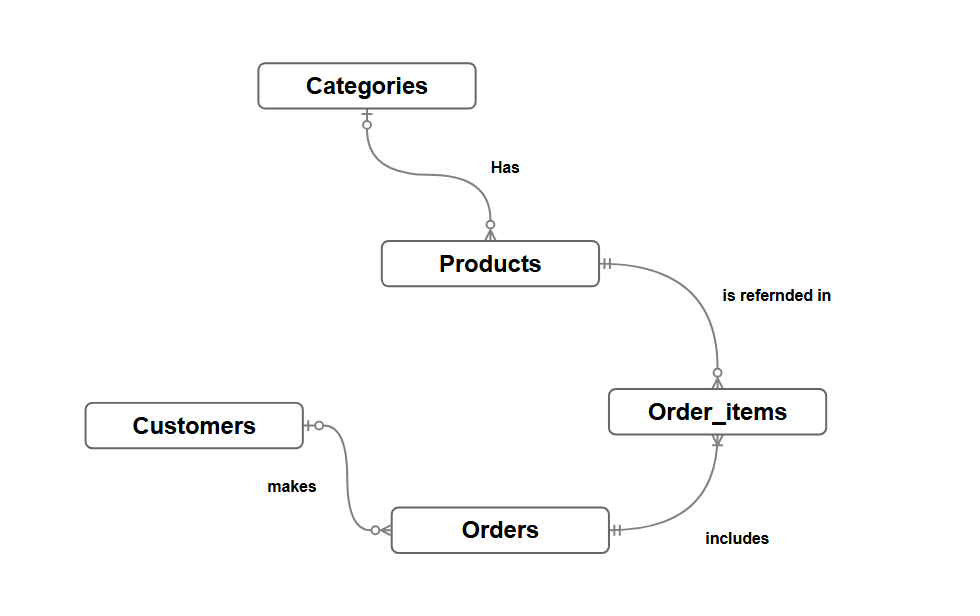

# Design Document

By Dmytro

## Scope
### What is the purpose of your database?
Inventory management and segmentation by category. Management of client records and data for those using the services. Creation and tracking of store orders.
### Which people, places, things, etc. are you including in the scope of your database?
Managers, database administrator, cashier, inventory specialist.
### Which people, places, things, etc. are *outside* the scope of your database?
Customers, suppliers.

## Functional Requirements
### What should a user be able to do with your database?
Database administrators must have direct access to the entire database and be able to modify it as needed. Managers must have read access to the entire database.
### What's beyond the scope of what a user should be able to do with your database?
Cashiers must be able to enter data into the database and register orders, but they cannot unilaterally delete records or change the format of entries.
Clients can view their bonus balance in their personal account, but they cannot alter the format or the entries themselves.

## Representation
### Entities
### Which entities will you choose to represent in your database?
- `Categories`
- `Products`
- `Order_items`
- `Orders`
- `Customers`

### What attributes will those entities have?
- **Categories** (`id`, `name`, `description`);
- **Products** (`id`, `barcode`, `name`, `category_id`, `price`, `stock_quantity`);
- **Customers** (`id`, `full_name`, `phone`, `bonus_points`, `created_at`);
- **Orders** (`id`, `customer_id`, `order_date`, `total_amount`, `status`);
- **Order_items** (`id`, `order_id`, `product_id`, `quantity`, `unit_price`);

* Why did you choose the types you did?
- INTEGER, TEXT, and NUMERIC were used as the primary data types in SQLite. INTEGER was used for primary keys, and NUMERIC for monetary values. TEXT was used for other types.

* Why did you choose the constraints you did?
-   PRIMARY KEY was used to represent unique records.
    FOREIGN KEY was used to preserve data integrity.
    NOT NULL was used to prevent the formation of empty rows where they should not be.
    UNIQUE was used to ensure the uniqueness of records.
    CHECK was used to so that data is recorded based on a specific condition.
### Relationships

In this section you should include your entity relationship diagram and describe the relationships between the entities in your database.

## Optimizations

In this section you should answer the following questions:

* Which optimizations (e.g., indexes, views) did you create? Why?

- The following indices were created:
    1. indx_customer to optimize searching by customer_id.
    2. indx_order_date to optimize searcing by order_date.
    3. indx_product_name to optimize searching by product_name.
    4. indx_product_barcode to optimize searching by barcode.

- Views:
    1. view_of_low_quantity_in_stock for a quick view of products running low in stock.
    2. view_pivot_table_of_products_by_the_categories for a quick view of the pivot table by product category.

- Triggers:
    1. "checking_subtraction_stock_quantity_products".
    It first checks for product availability before subtraction, ensuring the "CHECK ("stock-quantity" >= 0)" constraint is met. If an error occurs, it issues an appropriate text warning. If the check passes, it deducts the product upon sale.
    2. "counting_total_amount_and_adding_bonuses". Automatically calculates the total bill amount and adds bonuses to the client's balance.
## Limitations

In this section you should answer the following questions:

* What are the limitations of your design?
- This project was created for a specific local store. At its current stage, it does not support a complex system for calculating taxes or discounts, though this could be implemented in the future. If a store has many checkout counters operating in real time, it is better to use PostgreSQL.
* What might your database not be able to represent very well?
- The date and time format is set as CURRENT_TIMESTAMP, which defaults to Greenwich Mean Time. There are also risks of improper data normalization in the event of erroneous record updates.

